# UX review 1: the three levels

Reviewed on 2026-11-23, `main` at `3af2683` (PR #14 merged). Ticket: #15.

## Summary

The game plays from the first line to the last flag, and the drawing is its strength: the paper, the wobbling line, the stick man's poses and the handwriting all hold together. What is rough is almost everything the game *says* to the player. It never says what it is, which keys there are, that a level has ended, that a new one has begun, or that he died. The five things that would change the experience most:

1. **A new level does not look like a new level.** After a flag the picture cuts, in one frame, to one that is almost the same: he is in the same spot, the line is in the same place. The levels have names that are never shown. This is why the game felt like "just one level".
2. **The first sheet teaches nothing.** A man, a line and an empty box with a "1" under it. No title, and the walk and jump keys are never shown anywhere in the game.
3. **Level 3 is flown blind.** From the edge the far side is off the screen at every window size, the keys that fly the airplane appear only after it has left, and a flight with no key held is lost 1.4 seconds later.
4. **Failing costs chores.** Each lost airplane means waiting three seconds for a letter to fall, then five key presses and a walk, about seven seconds in all, to earn another 1.4 second try. Dying itself is an instant cut with nothing drawn.
5. **The end is a dead end.** "THE END" is written, he cheers for ever, no key does anything, and the only way to play again is to reload the page. On a portrait window the words are cut off at both sides.

Seventeen tickets are proposed at the end. If only a few are done, do A (turn the page), B (the first sheet), C (see where you are going), E (try again without the chores) and G (an ending you can leave), in that order.

## How it was reviewed

`verifications/15-ux-review/playthrough.mjs` plays levels 1, 2 and 3 in order from a fresh load of the real app (no `VITE_LEVEL`), with real key presses, at three windows: wide (1600 × 900), narrow (820 × 760) and portrait (480 × 860). It does what a new player does: waits, tries keys, walks into the gap before jumping it, flies with no key held, holds climb for the whole flight, jumps out, and then crosses. It took 61 screenshots per window and four short clips at the wide window; `proof/<window>/playthrough.txt` has what the sim held at each one. Times below come from the sim's tick count (60 a second).

The camera always shows 10.8 m of height (six stick men) and puts him in the middle, so the window's shape decides how far ahead he sees: 9.6 m at the wide window, 5.8 m at the narrow one and 3.0 m at the portrait one. Several findings come from that one fact.

Sizes are AGENTS.md's. Nearly everything here is Medium: client code in `hud/` or `render/`, sometimes with one new fact from the sim. Nothing is Small in the strict sense (docs or data only) except where said.

## Findings

### 1. A new level does not look like a new level

**Today.** He touches the flag, it goes up its stick in 0.6 seconds and he cheers. For the rest of a two second pause nothing moves. Then, in one frame, the picture is replaced: he stands at the left again and the line is where it was. Level 2 differs from level 1 by a gap 0.8 m wide. Level 3's first frame has an envelope on the line and the paper in the slot, and no gap or flag in view. Nothing says "level 2", and the names in the level files ("A walk", "A gap", "A long way across") are never drawn.

The last frame of level 1, and the next frame:

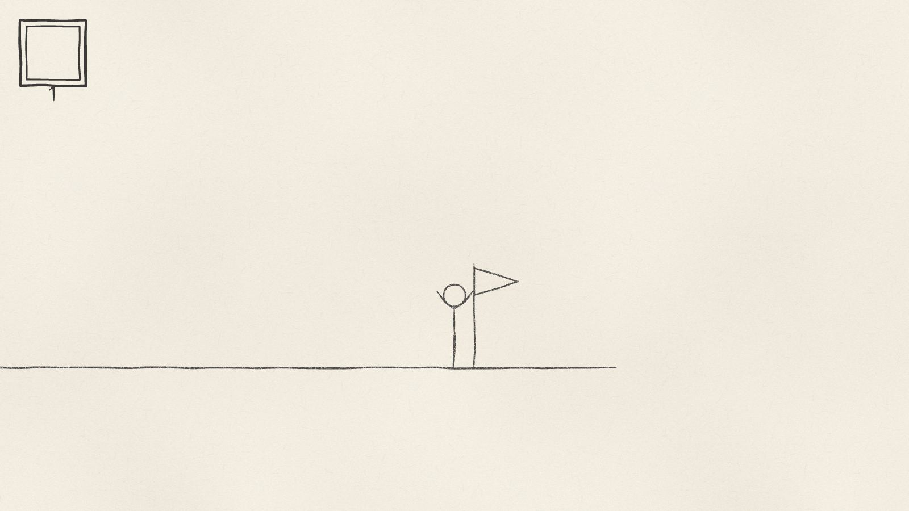
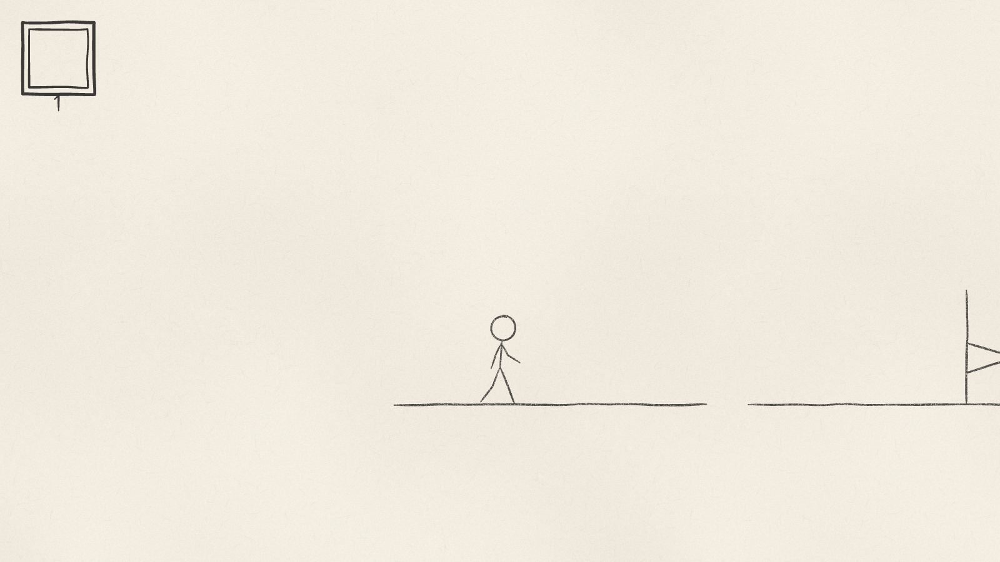

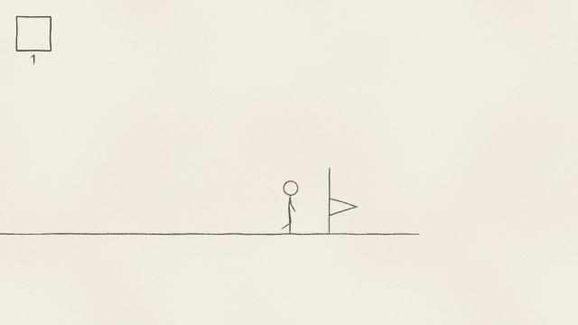

**Why it is rough.** The cut reads as a restart, the same as dying does (finding 4): same position, same framing, no words. A player cannot tell "I finished" from "I was sent back". On the portrait window level 2's gap is not even in view at the start, so the two levels look identical.

**Improvement.** Turn the page. When the pause ends, the sheet slides off to the left as a sheet would (its right edge drawn as a pencil line with a shadow of hatching), and the next sheet is under it with its number and name written at the top in the handwriting: "2. A GAP". The words stay for three seconds and are then rubbed out. A small page number in a bottom corner stays for the whole level, as in a notebook, which also says how far he has got. Shorten the dead part of the pause: the cheer is over after about one second.

**Size.** Medium. The name is already in `levelOf(sim)`; the transition and the words are client work in `scenes/` and `hud/`. The length of the pause is the sim's (`LEVEL_END.pauseBeforeNextLevel`), one tuning value.

### 2. The first sheet teaches nothing

**Today.** The first frame, and the same frame six seconds later:

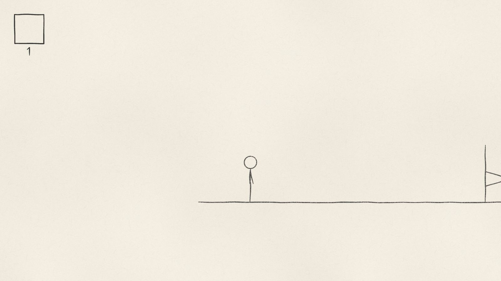

There is no title. The only mark besides him and the line is an empty box with "1" under it, which on level 1 reads as "level 1" or "one life", not as an item slot. Pressing J, K, 1 or Enter does nothing visible except that 1 draws a second box round the empty one. The keys that walk (arrows or A and D) and jump (up, W or space) are never shown at any point in the game: the HUD's prompts cover J, K and the flight keys only. At the wide window the flag is cut by the right edge of the view; at the narrow and portrait windows it is not in view at all:

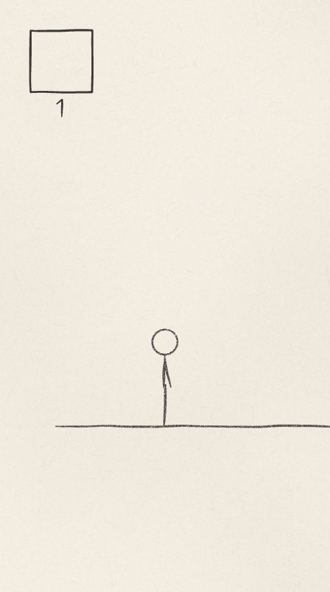

When each key is taught, over the whole game:

| Key | First needed | Taught |
|---|---|---|
| Walk (arrows, A and D) | Level 1, first second | Never |
| Jump (up, W, space) | Level 2's gap | Never |
| 1 (select the slot) | Never: reading the letter selects it for him | Only by the "1" under the slot |
| K | Level 3's letter | At the letter, by a prompt, when he is within reach. Good |
| J | Folding, after the letter | By a prompt, once the letter is put away. Good. Before that J with the paper does nothing and nothing says why |
| Climb and dive | The first tenth of a second of a flight | By prompts that appear after launch: too late (finding 3) |
| Space to jump out | Saving a flight that is falling short | By a prompt in flight. What jumping out is for is never said, and pressed over the gap it drops him into it (`proof/wide/51`) |

**Why it is rough.** A new player has to guess that this is a game, that it has started, and which keys to try. Level 2 then needs a jump that nothing has mentioned; the script's first attempt, walking on, falls in. J and K, the two keys the game does teach, are taught well: at the moment they are needed, in words that name the thing.

**Improvement.** Write on the sheet itself, as a doodle in the margin and not as HUD. On level 1, the game's name in the handwriting above the start, and beside him two small drawn keys, "← →", with "WALK". They are rubbed out once he has walked a couple of metres. On level 2, a drawn key and "JUMP" just before the gap, rubbed out once he has jumped it. This is the same "key in a box and a word" the HUD already draws, placed in the world at the spot where it is needed. Which keys they are stays in `client/src/input/`.

**Size.** Medium. Where a note sits is the level's business, so this adds a kind of placement to the level data: a note with its words ("WALK", "JUMP") and what it is about, never a key's name. The client draws the key beside it and rubs it out; what he has done so far can be read from `stickManOf`. Ticket N's doodles reuse the placement.

### 3. Level 3 is flown blind

**Today.** The letter says to carry the airplane to the edge. At the edge, this is the view before boarding:

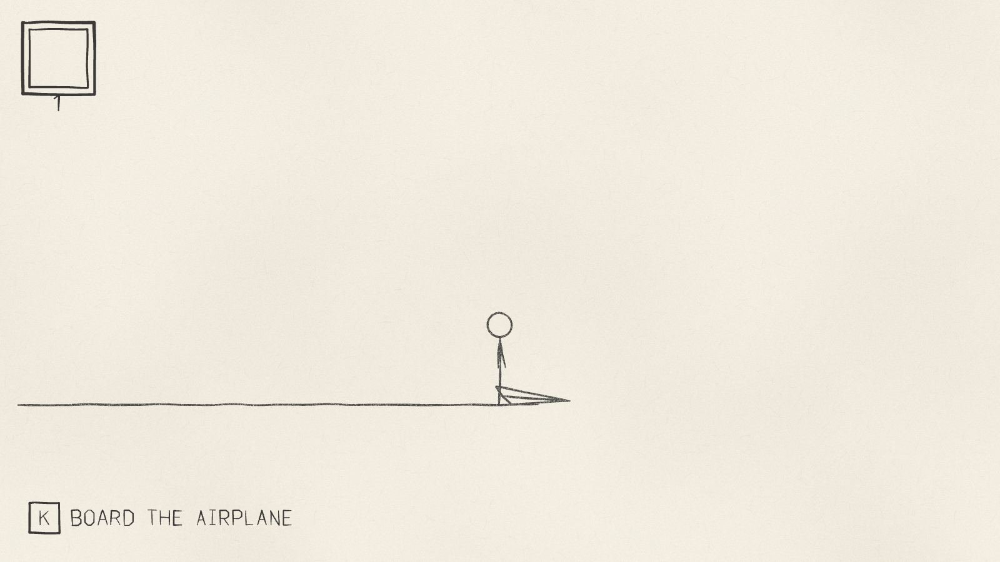

The far side begins 9.7 m from where he stands and the wide window shows 9.6 m, so the gap looks endless; the narrow and portrait windows show far less. The only prompt is "K board the airplane". The three keys that fly it appear in the frame after he has boarded, when it is already moving at 7.5 m a second:

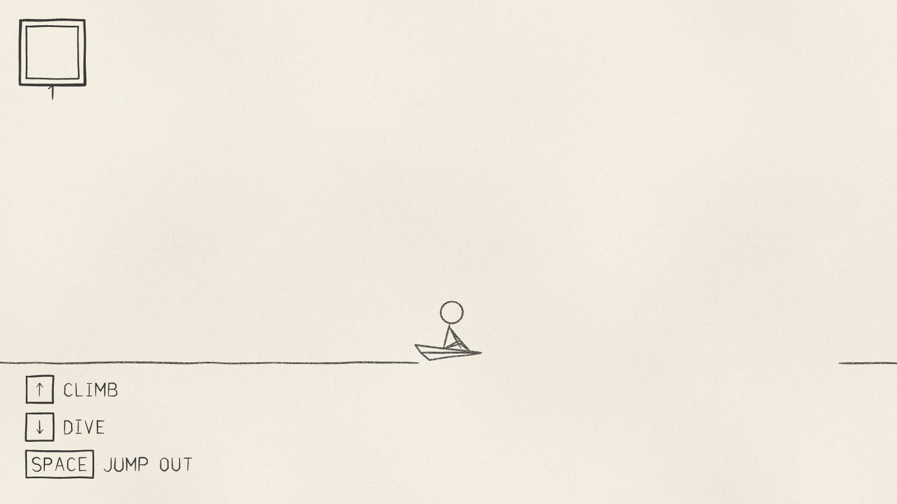

With no key held it is below the far side 1.2 seconds after launch and lost at 1.4 seconds. The far side slides into view only once he is in the air.

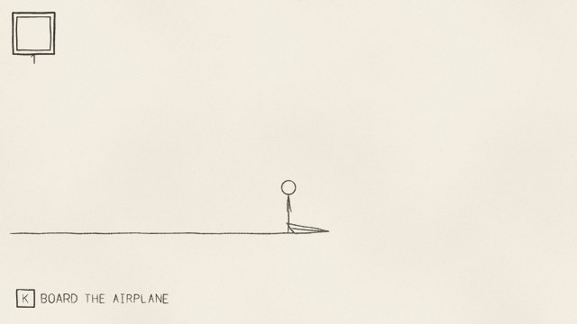

On the portrait window the prompts are drawn where the airplane flies, and it passes through the words:

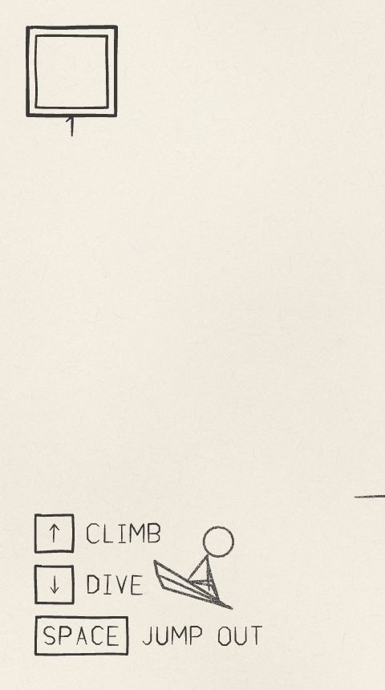

**Why it is rough.** The first flight is lost before the player can read three prompts, and he never saw what he was aiming for. Speed, the one number the glide is about, is not shown at all, so a stall arrives without warning (finding 8).

**Improvement.** Two changes that belong together.

- *The camera looks where he is going.* Standing at an edge, carrying the airplane, or seated in it, the camera eases ahead of him and, when the next floor line would still be out of view, pulls back until it is in view: the sheet held a little further away. Away from an edge it eases back. As a general rule the view should never be narrower than about twelve metres across, six ahead of him when he is centred, where the portrait window now shows six across and three ahead.
- *The flight keys are shown before the flight.* While "K board the airplane" is offered, write the climb and dive keys under it, so they can be read standing still. In flight, move them out of the flight path (top of the view, or beside the slot). This is a deliberate exception to AGENTS.md's "a key that would do nothing is not shown" (standing, the up key is a jump), so the ticket edits that line too.

**Size.** Medium for each; they are separate tickets (C and D below). The camera is `render/levelCamera.ts` only. The HUD's zoom follows the level's, so a camera that pulls back needs the HUD to keep its own size: that is the part to watch.

### 4. Dying is a cut, and trying again is a chore

**Today.** Walking into level 2's gap: he drops out of the bottom of the view, and 0.7 seconds after his feet left the line the picture cuts to him standing at the start.

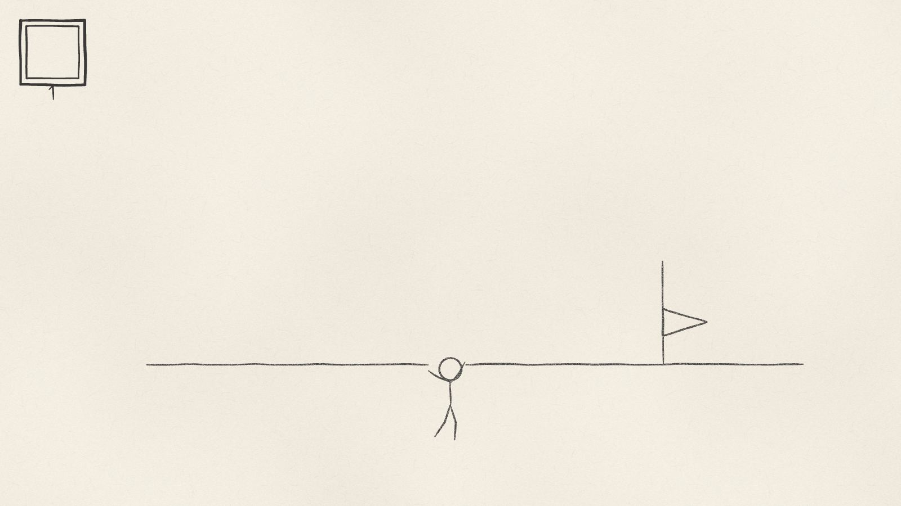

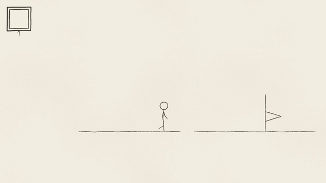

On level 3 a lost airplane also sends him to the start, with nothing in his slot. Then, with every key pressed the moment it can be: 3 seconds until a new letter has fallen and landed, K to read it, K to put it away, J to fold, a 6.5 m walk (3 seconds), J to set the airplane down, K to board. About seven seconds and five presses for each 1.4 second try.

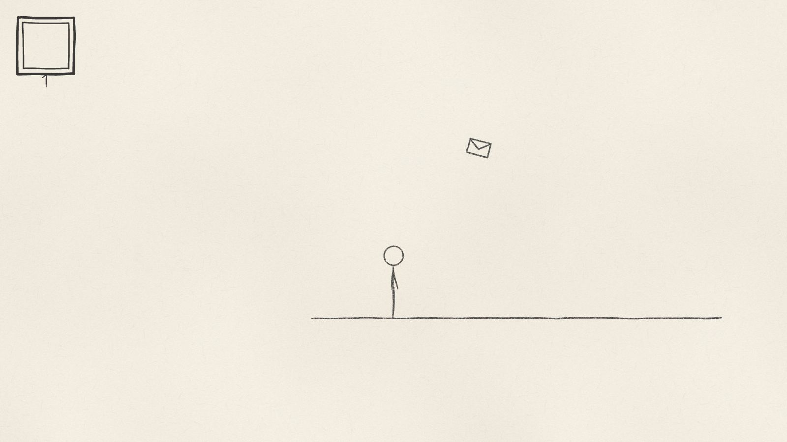

**Why it is rough.** The death has no beat: nothing is drawn, nothing is heard, and the cut is the same cut as finishing a level. The retry repeats a lesson already learned; reading the same letter a fourth time is not play. The falling letter itself is a good idea and worth keeping for the case it was made for (he has thrown everything away).

**Improvement.**

- *A beat for dying.* When he falls out of the sheet or the airplane is lost, hold for half a second, then rub the picture out with a few broad eraser strokes (the tooth of the paper shows through, a grey smear is left for a moment) and draw him again at the start, stroke by stroke, in about half a second. An eraser is the natural way to die on a sheet of paper.
- *Try again with what he had.* A restart of level 3 after he has learned the fold gives him the paper in his slot at once (or the folded airplane), so a retry is: walk, set down, board. The letter falls only when he has neither, as now, and does not need reading again to give the paper. Better still, restart him near the edge when that is where he last stood on the floor.

**Size.** Medium for each (F and E below). The first needs one fact from the sim (that he was lost, and when), drawn by the client. The second is a rule of the `letter` and `inventory` features, with its tests.

### 5. The end is a dead end

**Today.** At the last flag "THE END" is written across the sheet once the flag is up.

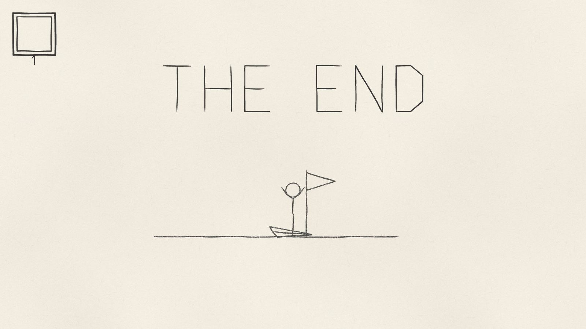

Ten seconds later nothing has changed: he is still cheering, the empty item slot is still drawn with its second box, and J, K, Enter, space and three seconds of holding right do nothing. There is no way to play again short of reloading the page. On the portrait window the words do not fit and run under the item slot:

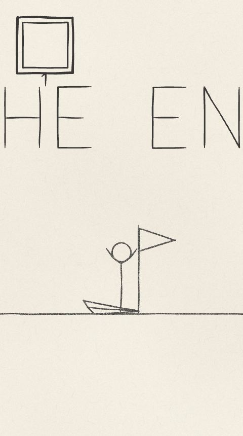

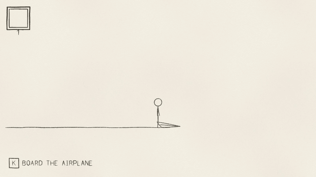

**Why it is rough.** The words are right and in theme, but the game stops answering, which reads as frozen. The crossing is the best moment in the game and it ends on a still.

**Improvement.** Size the words to the view's width so they always fit, and write them one stroke after another instead of all at once. After two seconds write a prompt under them in the usual form, a drawn key and "PLAY AGAIN", which turns back to the first sheet. Let him walk about under the words while he waits; a cheer that never stops looks stuck.

**Size.** Medium. Playing again needs a command the sim understands, since only the sim starts a level.

### 6. The HUD does not fit a narrow or portrait window

**Today.** The HUD is drawn at the level's zoom in fixed sizes, and the zoom depends on the window's height only. So on a narrower window the same boxes and words take more of the width.

- The prompts are cut off at the right edge of the portrait window: "PUT THE AIRPLANE DOW", "FOLD A PAPER AIRPLAN".
- The letter's sheet is drawn over the item slot at the narrow and portrait windows (already listed in #12).
- At the portrait window the letter takes most of the width and the upper half of the view, and its first word is inside the slot's box.

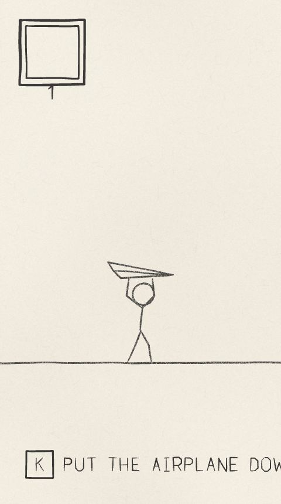 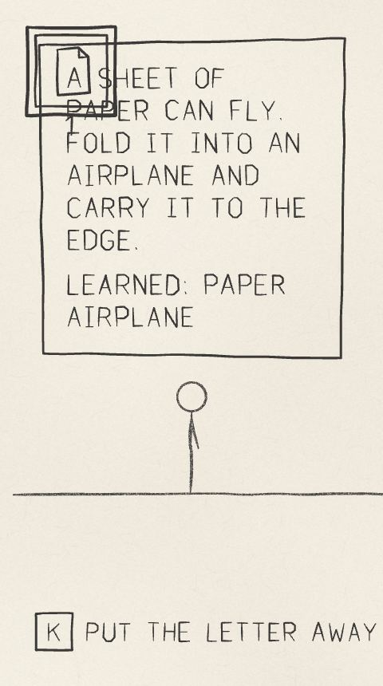

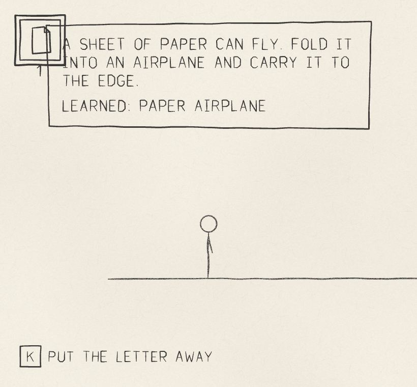

**Why it is rough.** These are the only words in the game and they are the ones that get cut.

**Improvement.** Lay the HUD out against the width it has: prompts wrap onto a second line instead of running off; the letter's sheet starts below the item slots, or the slots are not drawn while a letter is held up; "THE END" as in finding 5. With the minimum view width from finding 3 most of this pressure goes away, so do that first.

**Size.** Medium. `hud/prompts.ts`, `hud/panels.ts`, with their tests.

### 7. The item slot is noise for two levels and unclear in the third

**Today.** The slot is drawn from the first frame of level 1, empty, and stays empty until level 2's flag. Its "1" is the key that selects it, which nothing says. Selecting draws a second, heavier box whose bottom edge runs through the numeral, so the "1" becomes a tick mark:

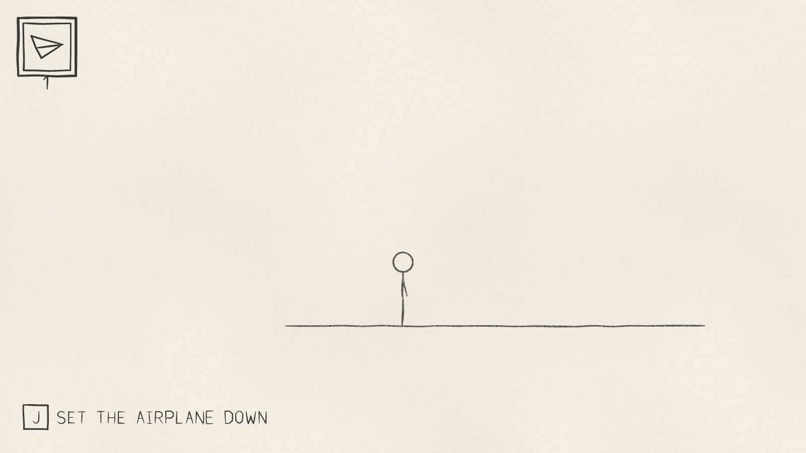

With one slot, selecting changes nothing the player can see happen: reading the letter selects it for him, and after that it stays selected. Before the letter is read, J with the paper in the slot does nothing and no prompt says why. From the moment the airplane is set down until the end of the game the slot is an empty double box, the heaviest mark on the sheet, in the corner the eye starts from.

**Why it is rough.** A HUD element that is empty or meaningless most of the time teaches the player to ignore the HUD.

**Improvement.** Draw no slot until he owns something: the box is drawn, stroke by stroke, at the moment level 2's flag gives the paper (finding 8). Put the numeral where the second box cannot reach it, or mark the selected slot the way a hand would, with a quick underline or a circle round it, instead of a second rectangle. While the slot is empty draw it lightly. Draw the whole HUD with a harder pencil than the world (a little lighter and thinner), so the level stays the darkest thing on the sheet.

**Size.** Medium, at the low end: `hud/itemSlots.ts` and its tests. The lighter HUD pencil is a value in `render/strokes/` used by the HUD's layers.

### 8. Several actions have no visible answer

What each action shows today:

| Action | What is drawn | Verdict |
|---|---|---|
| Reaching a flag | The flag climbs the stick, he throws his arms up | Good |
| Level 2's flag gives the paper | A paper icon is in the slot from one frame to the next, while the eye is on the flag | Easy to miss |
| Reading the letter | A hand-cut sheet with the text and "LEARNED: PAPER AIRPLANE" | Good; the best HUD moment |
| Folding | The icon in the slot changes; he does not move, and his hands are empty before and after | Weak |
| Setting the airplane down | It is on the floor in front of him | Fine |
| Lifting it | He bends, holds it at his waist, then over his head | Good |
| Boarding | He is seated and it is moving, in one frame | Abrupt, see finding 3 |
| Gaining and losing speed | Nothing | Missing |
| Stalling | Its nose drops level and it falls | No warning before, no mark when |
| Landing | It slides to a stop and he stands up | Good |

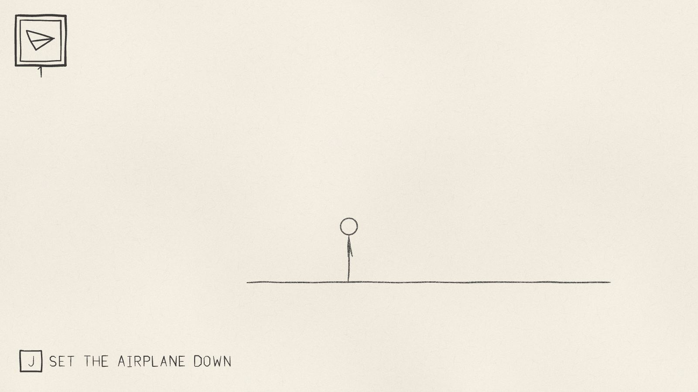
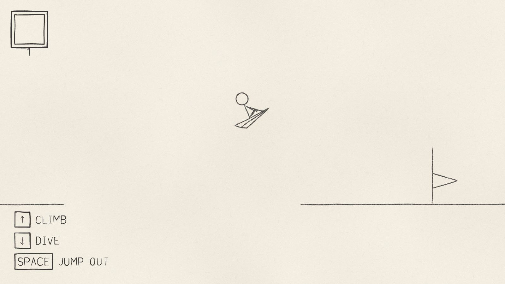

Also: once read, the letter is gone from the floor, so its one sentence cannot be read again. The recipe list the ticket asks about no longer exists: since #13 folding is one press, and "LEARNED: PAPER AIRPLANE" on the letter plus the "J fold a paper airplane" prompt are all that is left of it. With one recipe that is enough, and it is clearer than a list was.

**Why it is rough.** The actions that matter most to the story (he is given paper, he folds it, it flies or fails) are the ones with the least drawn. The player learns what happened from a corner icon and a line of text instead of from the stick man.

**Improvement.**

- *The paper is seen changing hands.* At level 2's flag a sheet comes loose from the flag's stick and flutters into the corner, where the slot is drawn round it. When he folds, he holds the sheet in front of him and three quick creases turn it into the dart (under half a second, view only). An item in the selected slot is drawn small in his hand.
- *Speed is drawn.* A few short pencil streaks trail the airplane, longer the faster it goes. As it nears the stall speed they shorten to nothing and the airplane shivers; at the stall a small scribble is left in the air where it gave up. This is how a comic draws speed, and it gives the stall a warning the player can learn from.
- *The letter stays.* After reading, it lies on the floor, opened, and can be read again.

**Size.** Medium for the hands (J below) and Medium for the speed streaks (K). Letting the letter stay is a rule of the `letter` feature and goes with ticket E, which changes the same rules.

### 9. Three wordings and two keys for putting the airplane down

**Today.** J "SET THE AIRPLANE DOWN" takes it from the slot to the floor. K "LIFT THE AIRPLANE" picks it up, and K "PUT THE AIRPLANE DOWN" puts it back. K "BOARD THE AIRPLANE" replaces "lift" only when it rests on an edge over a gap. A player who sets it down where he folded it, which the script did, is offered "lift" and nothing else; nothing says that boarding exists or what would make it possible, and at the edge nothing says why the word changed.

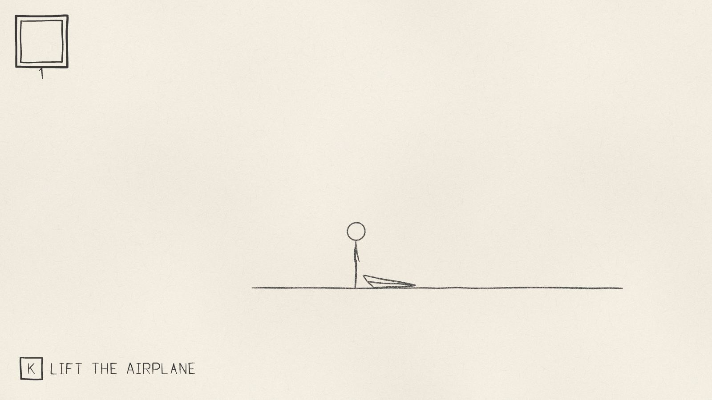

**Why it is rough.** The rule is good (one press, one meaning, ADR 0003), but its conditions are invisible, and two different phrases for the same act suggest two different acts.

**Improvement.** Use one phrase, "PUT THE AIRPLANE DOWN", for both. Show the edge is special: an airplane resting on an edge rocks a little with its nose out over the gap, and a faint dotted pencil arc leaves its nose, the way a child draws where a thrown thing will go. Away from an edge neither is drawn. No new words are needed.

**Size.** The wording is one line in `hud/prompts.ts` and its test: Medium by the letter of AGENTS.md, a few minutes' work in practice. The cue is Medium (`render/airplane.ts`).

### 10. The look: strong lines on an empty, edgeless sheet

**Where the idea is strong.** The grain of the paper and the way every line wobbles and "boils" a little. The stick man's poses: the walk, the cheer, the lift, carrying overhead, sitting in the airplane and tipping with it. The envelope, the hand-cut letter with its corners off true, and the capitals of the handwriting, which match the lines around them. The airplane itself.

**Where it breaks.**

- *It is not a sheet.* The paper has no edge, margin, ruling, punch holes or fold: it is a beige background that goes on for ever. The floor line simply stops, and what is under a gap is more of the same, so nothing says a fall is fatal.
- *It is empty.* The floor sits at 72% of the height and everything above it is blank on all three levels. Level 1 is fourteen metres of one line.
- *He stands in the middle.* Half the view is always behind him. Finding 3's camera fixes this.
- *Standing still, he is still.* In six seconds of waiting the picture does not change beyond the line's boil. A shift of weight or a look around would say the game is alive and waiting.
- *The HUD is the heaviest thing drawn* (finding 7).

**Why it is rough.** The theme promises a drawing on a sheet of paper, and what is on screen is a few lines on a colour. The more the picture looks like something a hand drew on a real page, the less any of the other findings will feel like missing interface.

**Improvement.** Draw the sheet: its edges just inside the level's ends, a margin line down the left, perhaps faint ruling, so a gap is a tear or simply the place where nobody drew a floor, and falling is falling off the page. Give levels doodles as data: a sun in a corner, a cloud, a scribbled-out mistake, an arrow somebody drew toward the flag. They cost a few strokes each, fill the blank, and can point the way. Add an idle pose after a few seconds.

**Size.** The sheet's edges and margin: Medium (`render/paper.ts`, and the camera must not show past them). Doodles: Medium for the first, which adds a placement kind and its renderer; Small for each level's doodles after that, which are data. The idle pose: Medium (`render/stickMan.ts`).

### 11. Sound

There is none, and the game is quiet enough that this is not the first thing to fix. It would matter most, in order:

1. **Flight.** A paper flutter whose pitch follows the speed is a second way to hear a stall coming, on top of finding 8's streaks.
2. **The level change and the death.** A page turning, and an eraser rubbing: both make findings 1 and 4 land.
3. **The pencil.** A short scratch whenever something is drawn in front of the player: the flag going up, the slot appearing, the words of the end.
4. **Paper in his hands.** The crackle of folding, the rustle of the letter.
5. **Footsteps.** Soft taps on paper; last, because they repeat the most and tire soonest.

**Why it is rough.** Every finding above is about the game not answering the player, and sound is the cheapest answer there is: it works at any window size and does not need the eye to be in the right place.

**Improvement.** All of it should be recorded from the real things (a pencil, a sheet, an eraser), dry and close, with no music at first.

**Size.** Large for the first sound: it is new architecture (how the view learns that something happened in the sim without the sim knowing about sound, how sound is loaded, how it is muted) and needs an ADR. Each sound after that is Medium or Small.

## Bugs and mismatches

Plainly wrong rather than rough. None was fixed here.

1. **"THE END" does not fit a portrait window** and runs under the item slot (finding 5). `hud/theEnd.ts` uses a fixed letter height.
2. **Prompts are cut off at the right edge of a portrait window** (finding 6). `hud/prompts.ts` never wraps.
3. **The second box of a selected slot covers the slot's numeral** (finding 7). `hud/itemSlots.ts`: the top of the numeral is 1.13 box heights down and the second box's lower line is at 1.12, half as heavy again as a usual line, so the 1's flag is swallowed and a tick is left.
4. **The letter's sheet is drawn over the item slot** on narrow and portrait windows. Already in #12.
5. **A climb that starts a moment late can be held for ever.** `level3.test.ts` counts a climb from the tick he boards: 16 to 42 ticks of it cross, and its test "cannot be finished by climbing all the way" shows that holding on from that tick stalls short and restarts the level. A person cannot press climb on the boarding tick. The script pressed it a quarter of a second after boarding and never let go: the airplane stalled over the gap (x = 17.2 m, 3.1 m up), drifted on, and came down on the far side at x = 20.1 m, where he stood up unharmed (`proof/wide/46` to `48`). The reviewer of this report replayed it in the sim and found the same: started 15 ticks late the climb crosses however long it is held, started 10 ticks late or less it does not. So for a human player the rule "climb too long and you stall into the gap" mostly does not hold, and the only flights that failed here were the one with no key held and the one he jumped out of. The texts and the test are right about what they measure; what they measure is not how the level is played.
6. **Flying over the flag does not reach it.** By design (`features/flag/index.ts`: a flag is reached on his own feet), but nothing on screen says so, and a flight that lands beyond the flag looks like a missed win. Not captured in the proof kept; noted because it reads as a bug to a player.

## Proposed tickets

Each is one PR. None has been filed. The order is the order I would do them in.

| | Ticket | What it does | From | Size |
|---|---|---|---|---|
| A | Turn the page between levels | The finished sheet slides away; the next has its number and name written at the top, and a page number in the corner. The pause is shortened | 1 | Medium |
| B | The first sheet says what to do | The game's name on level 1; a walk note beside him and a jump note before level 2's gap, each with its key drawn by the client and rubbed out once used. Adds notes to the level data | 2 | Medium |
| C | See where you are going | The camera eases ahead at an edge, while carrying and in flight, pulls back until the next floor is in view, and never shows less than about twelve metres across | 3, 6, 10 | Medium |
| D | Flight keys before the flight | Climb and dive are shown while boarding is offered, and all three flight prompts are kept out of the flight path. Edits AGENTS.md's rule about keys that would do nothing | 3 | Medium |
| E | Try again without the chores | A restart of level 3 gives back the paper (or the airplane) at once; a read letter stays on the floor and can be read again; the falling letter is kept for when he has nothing | 4, 8 | Medium |
| F | Rubbed out and drawn again | Dying holds a beat, the picture is erased and he is redrawn at the start | 4 | Medium |
| G | An ending you can leave | "THE END" sized to the view and written stroke by stroke, a "play again" prompt, and he can move | 5, bug 1 | Medium |
| H | A HUD that fits its window | Prompts wrap, the letter sits clear of the slots (#12's first item). Easier after C | 6, bugs 2 and 4 | Medium |
| I | A quieter item slot | No slot while he owns nothing, which covers the end as well; a selection mark that leaves the numeral alone; a lighter pencil for the HUD | 7, bug 3 | Medium |
| J | Paper seen changing hands | The sheet flutters from level 2's flag to the slot; folding is three creases in his hands; the held item is drawn in his hand | 8 | Medium |
| K | Speed you can see | Pencil streaks behind the airplane that shorten toward a stall, a shiver before it and a scribble where it happens | 8 | Medium |
| L | One way to say "put it down", and an edge that looks like one | One wording for J and K; the airplane rocks on an edge and a dotted arc leaves its nose | 9 | Medium |
| M | The sheet has edges | Edges and a margin line on the paper, and a camera that does not look past them | 10 | Medium |
| N | Doodles on the levels | Drawings as level data (a sun, a cloud, an arrow toward the flag), with a first set for the three levels. After B, whose placement it extends | 10 | Medium |
| O | He waits like a person | An idle pose after a few seconds of standing | 10 | Medium |
| P | Sound | The first sounds (flight, page turn, eraser) and the ADR for how the view hears the sim | 11 | Large |
| Q | A late climb should not be a free pass | Decide whether a climb held for ever should cross when it starts a moment after boarding; if not, retune `FLIGHT` and add late starts to `level3.test.ts` | bug 5 | Small (tuning values and their test) |

A, B, C, E and G together answer the first impression that this was one level with nothing to tell the player. D, K and Q make level 3 fair; F makes failing readable. The rest is polish, and P is the one that needs a decision before any work. E should land before J (both touch what he holds at a restart), and I before G (I takes the slot away at the end).
